<div align="center">

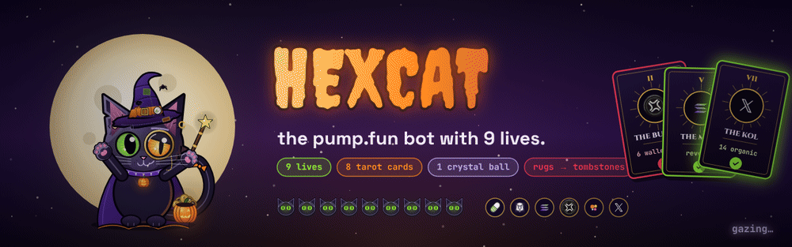


<p>


</p>

### The black cat was never bad luck. It was early.

[**🔮 Summon it**](#-summon-it-quickstart) · [**🃏 The 8 cards**](#-the-eight-cards) · [**🐈‍⬛ 9 lives**](#-nine-lives) · [**🪄 Build your own**](#-build-your-own-step-by-step) · [**🎃 Press kit**](#-press-kit) · [**❓ FAQ**](#-faq)

</div>

---

<table>
<tr>
<td width="44%">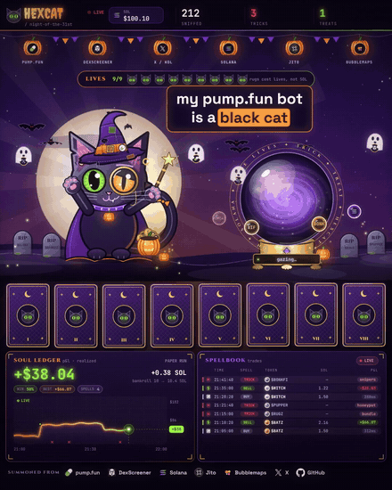</td>
<td>

### 98 out of 100 coins die on the curve

On its busiest day pump.fun launched **~42,000 tokens**. Historically only **~1.4%** ever graduate to a DEX, and only **~3%** of users have made more than $1,000.<sup>[1](#sources)</sup>

So I gave a black cat **9 lives** and sent it to find the other 2.

- 🔮 every new mint drops into a **crystal ball**
- 🃏 the cat flips **8 tarot cards** on it, each card checks one thing
- 💀 **one red card = TRICK.** the dev gets a tombstone, forever
- 🍬 **all eight green = TREAT.** it buys, then ladders out
- 🐈‍⬛ **9 lives** = 9 stop-losses per night. at 0 the cat goes to sleep
- 🧪 **paper trading by default.** live mode is opt-in, burner wallet only

🎬 full video: [`assets/hexcat-demo.mp4`](assets/hexcat-demo.mp4)

</td>
</tr>
</table>

## 📜 The lore

In medieval Europe a black cat crossing your path meant death was coming.
Sailors believed the opposite: a black cat that walked onto a ship **and stayed** meant a safe voyage. One that walked on and then **walked off** meant the ship would sink.<sup>[2](#sources)</sup>

**HEXCAT runs on the sailors' rule.** If the cat walks away from a coin, you walk away too.

## 🎭 Moods

<div align="center">

| gazing | reading the cards | **TRICK!** | **TREAT!** | −1 life |
|:---:|:---:|:---:|:---:|:---:|
| 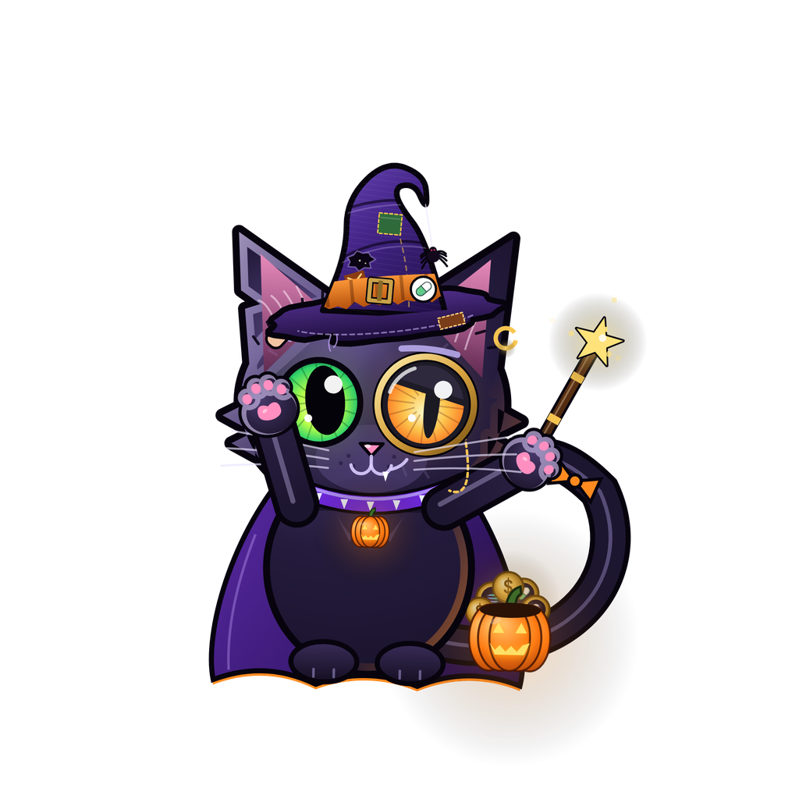 | 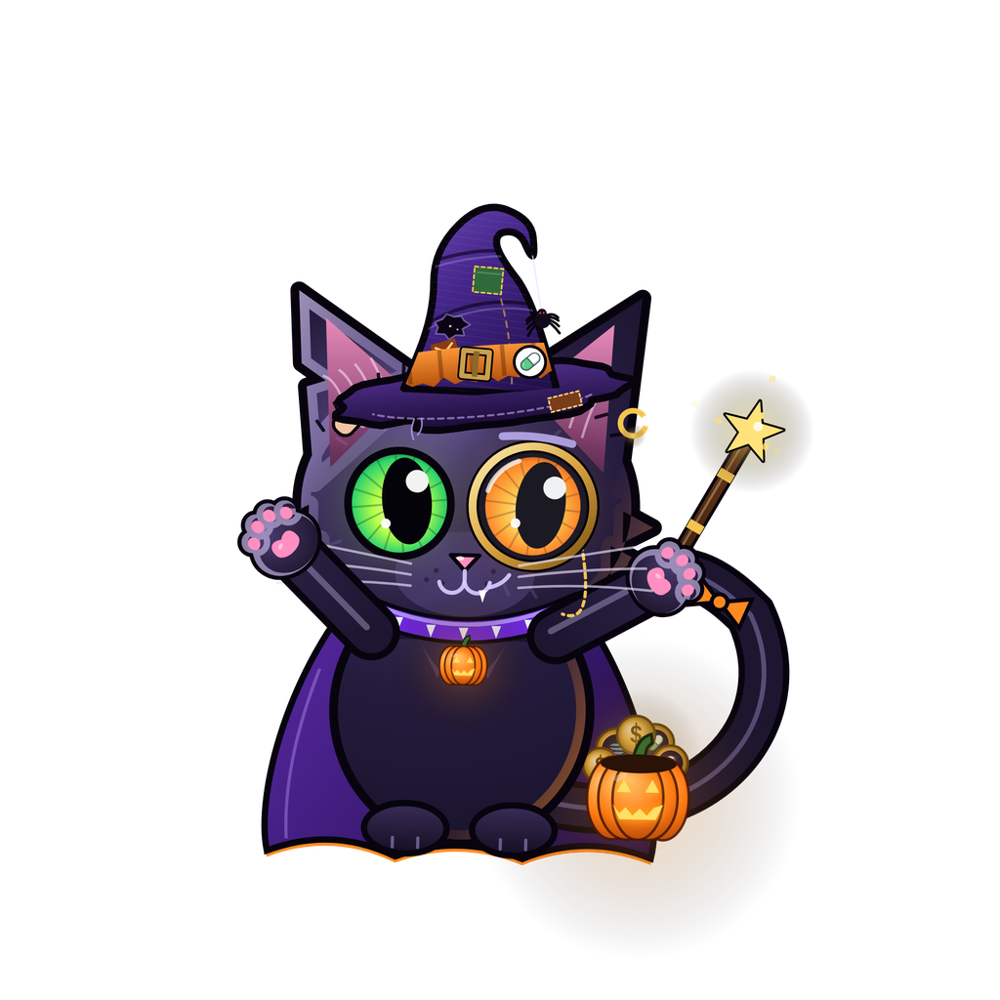 | 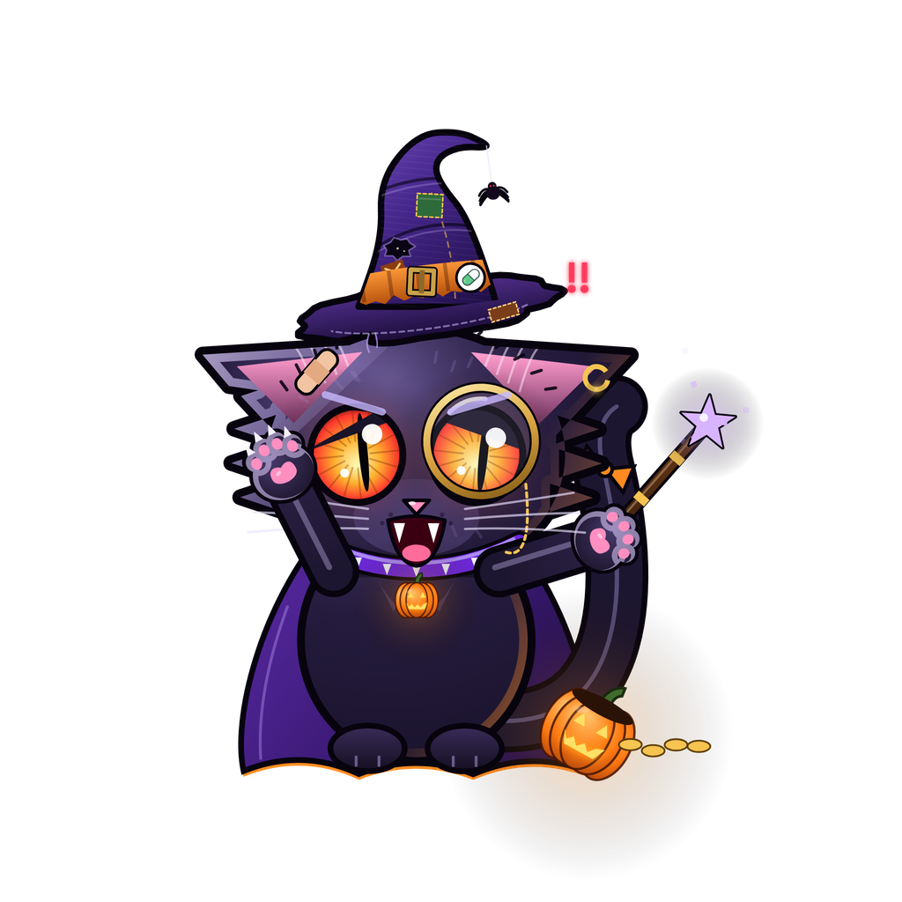 | 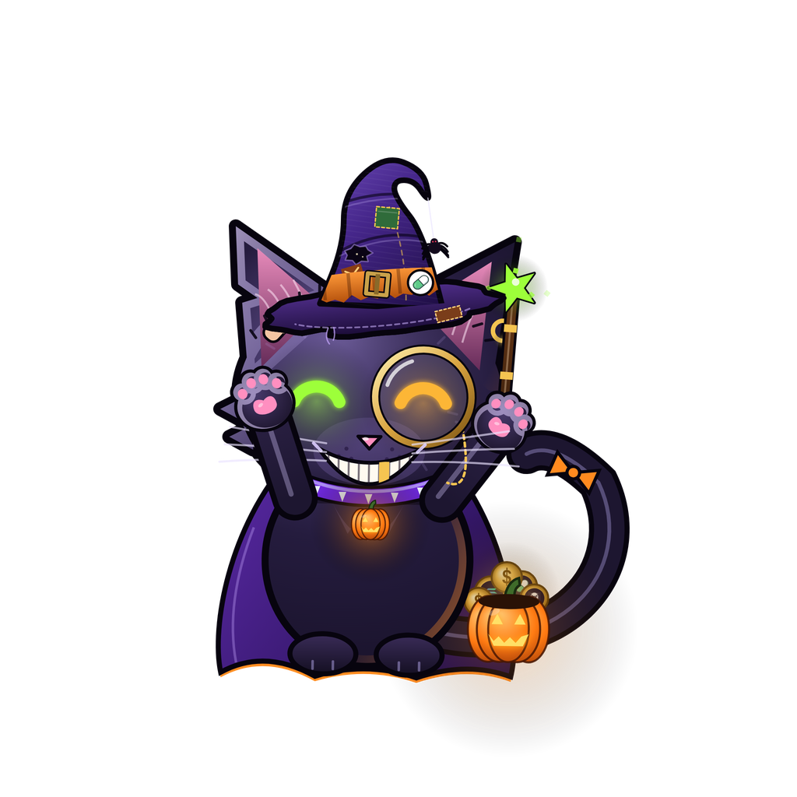 | 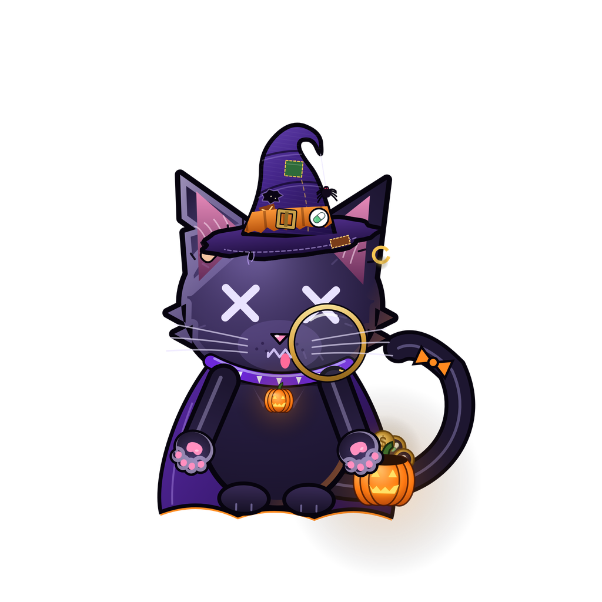 |
| smug side-eye, waving | paw on chin, wand on the ball | monocle pops off, claws out | cheshire grin, gold tooth | X eyes, paws limp |

</div>

### 🧥 The fit (every detail is lore)

| item | why |
|---|---|
| **green + amber eyes** | one eye watches the chart, the other watches the dev |
| **gold monocle** | flies off every time it smells a rug |
| **tattered witch hat** | patched, torn brim, floppy tip. survived every rug season since 2024 |
| **spider on a thread** | hangs from the hat tip. nobody knows where it came from |
| **wand** | reads coins inside the ball, zaps rugs, conjures green candles |
| **pumpkin bucket of coins** | treats only. drops it the moment it hisses |
| **band-aid on a torn ear** | a 2024 rug. the cat remembers. |
| **pump.fun pin** | home turf |

---

## 🃏 The eight cards

<div align="center">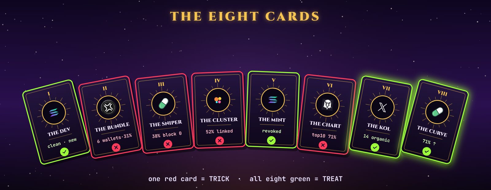</div>

| | card | reads | TRICK when |
|:-:|---|---|---|
| **I** | THE DEV | the graveyard | this wallet already has a tombstone → **instant hiss, no other card is drawn** |
| **II** | THE BUNDLE | buys in the launch window | ≥4 linked wallets ape the first seconds and hold > 15% |
| **III** | THE SNIPER | block-0 buys | snipers took > 12% of supply |
| **IV** | THE CLUSTER | who funded the top holders | one funder holds > 20% (or a dev-funded cluster > 5%) |
| **V** | THE MINT | mint & freeze authority | either is still LIVE: dev can print or freeze your bag |
| **VI** | THE CHART | top-10 + sells | top-10 > 35%, or 15+ buyers and **zero sells** (honeypot smell) |
| **VII** | THE KOL | X mentions | paid shills outnumber organic posts |
| **VIII** | THE CURVE | bonding curve % | too early (< 8%) or about to migrate (> 92%) is a shrug, not a buy |

## 🐈‍⬛ Nine lives

The cards stop rugs **before** you're in. Lives cover what's left after:

- every **stop-loss** that actually hits costs **1 life**
- hitting **TP2 (+300%)** earns **1 life** back
- **0 lives = the cat curls up and stops trading until tomorrow.** a built-in kill switch for bad nights

## 🌑 How a coin dies

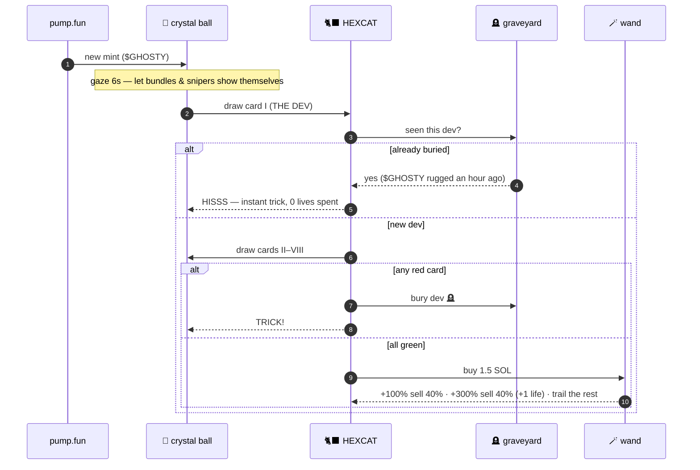

---

## 🔮 Summon it (quickstart)

```bash
git clone https://github.com/MyWestLord/hexcat && cd hexcat
make install     # venv + deps + config.yaml + .env
make paper       # paper spells only. watch it hiss at rugs in your terminal
make test
```

Live mode (burner wallet, small size, you were warned):

```bash
pip install solders
# .env → HEXCAT_LIVE=1, HEXCAT_PRIVATE_KEY=<base58 burner>, HEXCAT_RPC_URL=<private rpc>
make live
```

What it looks like:

```text
HEXCAT awake · PAPER · lives ●●●●●●●●● · 1402 graves

$GHOSTY 7xKq…pump
  ✓    I THE DEV      never seen
  ✕   II THE BUNDLE   6 wallets · 31%
  ✕  III THE SNIPER   38.0% block 0
  ✕   IV THE CLUSTER  52% linked · dev
  ✓    V THE MINT     revoked
  ✕   VI THE CHART    top10 71%
  ✕  VII THE KOL      2 organic · 5 paid
  ✓ VIII THE CURVE    23%
  TRICK! 6 wallets · 31%  🪦 tombstone #1403

$GHOSTY2 3vTz…pump
  ✕    I THE DEV      MATCH $GHOSTY (6 wallets · 31%)
  TRICK! MATCH $GHOSTY  🪦 tombstone #1403

$PUMPKN 9mPd…pump
  ✓ … all eight green …
  TREAT! 8/8 cards · buy 1.5 SOL (paper)
TP1 $PUMPKN +0.600 SOL · night +0.600 · ●●●●●●●●●
```

## 🪄 Build your own (step by step)

<details><summary><b>1 · Catch mints the second they exist</b> → <code>hexcat/feeds/pumpportal.py</code></summary>

PumpPortal's public websocket: `subscribeNewToken` for every mint, then `subscribeTokenTrade` for that mint so you see every buy and sell from second zero. Reconnect with backoff.
</details>

<details><summary><b>2 · Gaze before you judge</b> → <code>ball.py · GAZE_S</code></summary>

Bundles and snipers land in the first seconds. Judge at t=0 and you're blind; judge at t=60 and you're exit liquidity. 4–8 s on a good RPC.
</details>

<details><summary><b>3 · Graveyard first (it's free)</b> → <code>graveyard.py</code> · card I</summary>

A sqlite table of buried devs. Known rugger → trick without a single RPC call. Every trick writes a new tombstone. After a few nights this is your best edge.
</details>

<details><summary><b>4 · Bundles & snipers</b> → cards II, III</summary>

Group buys inside the launch window by wallet. Many distinct wallets in the same seconds holding a big % = a bundle. Non-dev share of that window = snipers.
</details>

<details><summary><b>5 · Funder clusters</b> → card IV</summary>

`getTokenLargestAccounts` → owner of each account → oldest signature → who sent the first SOL. Group holders by funder. One funder pretending to be ten wallets is still one person.
</details>

<details><summary><b>6 · Authorities</b> → card V</summary>

`getAccountInfo(mint, jsonParsed)` → `mintAuthority`, `freezeAuthority`. Either one alive = the dev can print or freeze.
</details>

<details><summary><b>7 · Concentration & the honeypot smell</b> → card VI</summary>

Top-10 share (skip #1, that's the curve / AMM vault). And if 15+ wallets bought and nobody has managed to sell, walk away.
</details>

<details><summary><b>8 · Real KOLs vs paid shills</b> → card VII</summary>

X recent search for mint / ticker. Count organic posts vs `#ad`, `promo`, `100x`, rocket spam. More paid than organic → trick.
</details>

<details><summary><b>9 · Verdict, wand, ladder</b> → <code>tarot.verdict</code>, <code>wand.py</code>, <code>ledger.py</code></summary>

One red card → TRICK. Two shrugs → skip. All green → buy. Live execution uses PumpPortal's local-transaction API: it returns an unsigned tx, you sign locally with your burner key and send through your own RPC. Your key never leaves your machine.
</details>

<details><summary><b>10 · Lives</b> → <code>lives.py</code></summary>

A stop-loss costs a life, TP2 gives one back, zero lives ends the night. It's a loss budget with a cat face.
</details>

---

## 🎃 Press kit

Free for memes, threads and banners. Tag the cat.

<div align="center">

| | | |
|:---:|:---:|:---:|
| 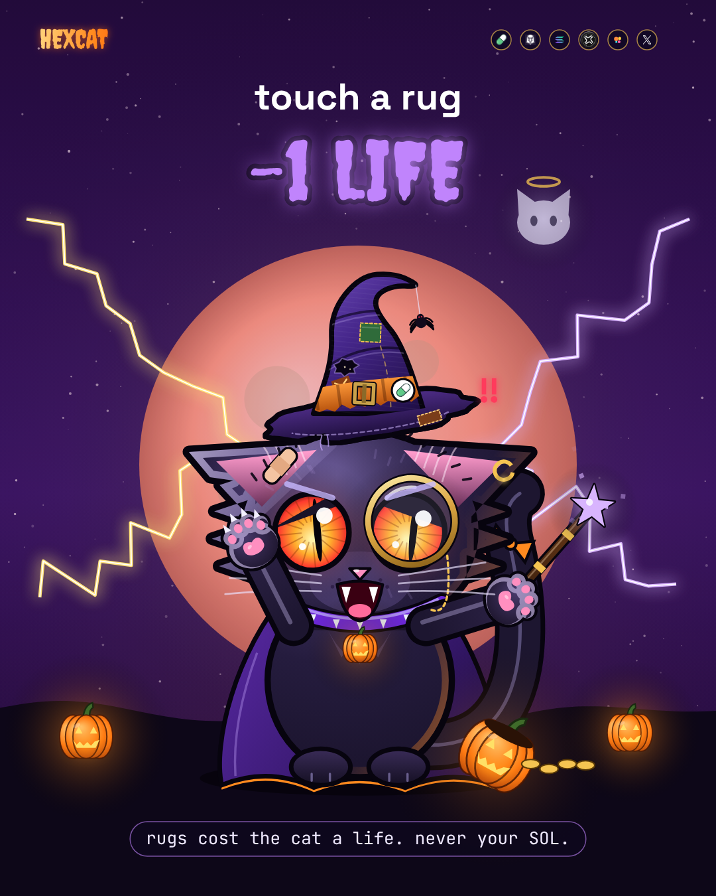 | 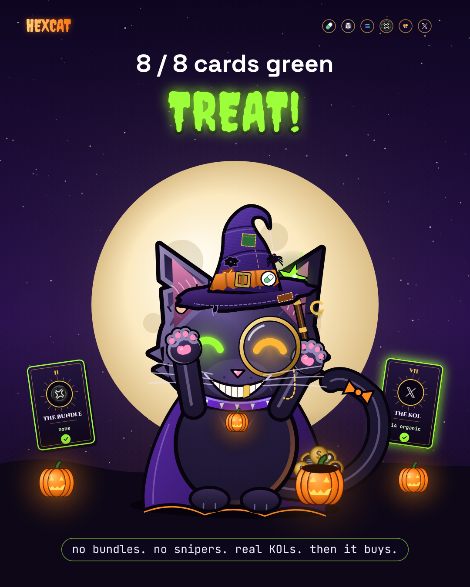 | 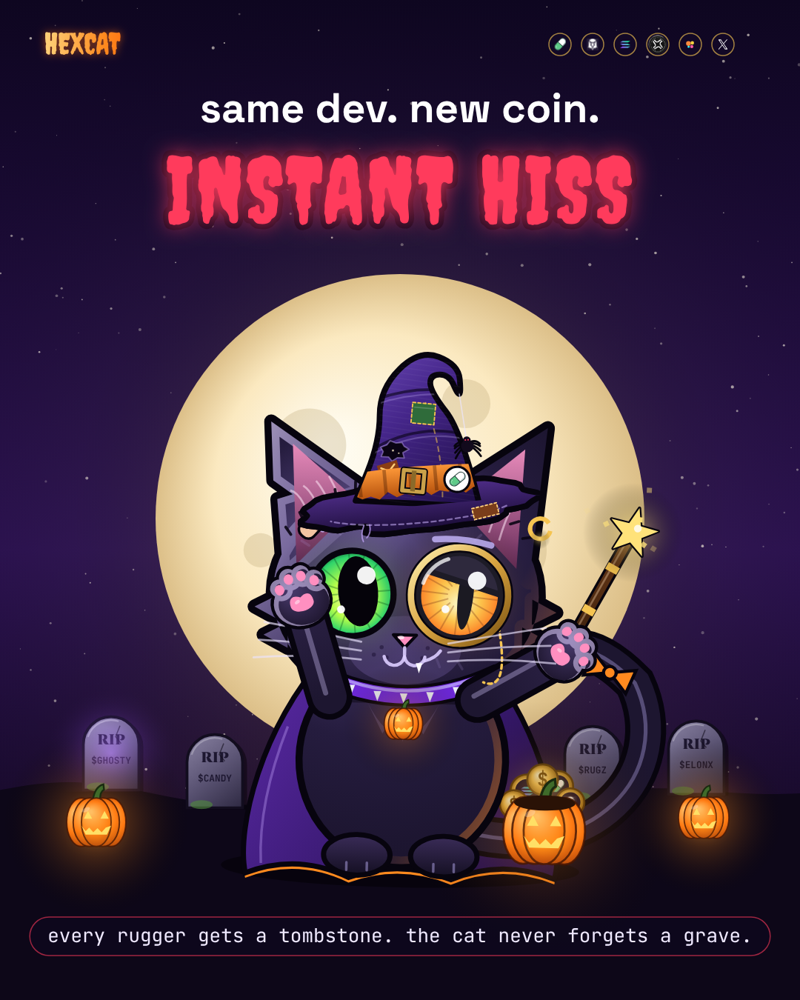 |
| `poster-life.png` | `poster-treat.png` | `poster-grave.png` |
| 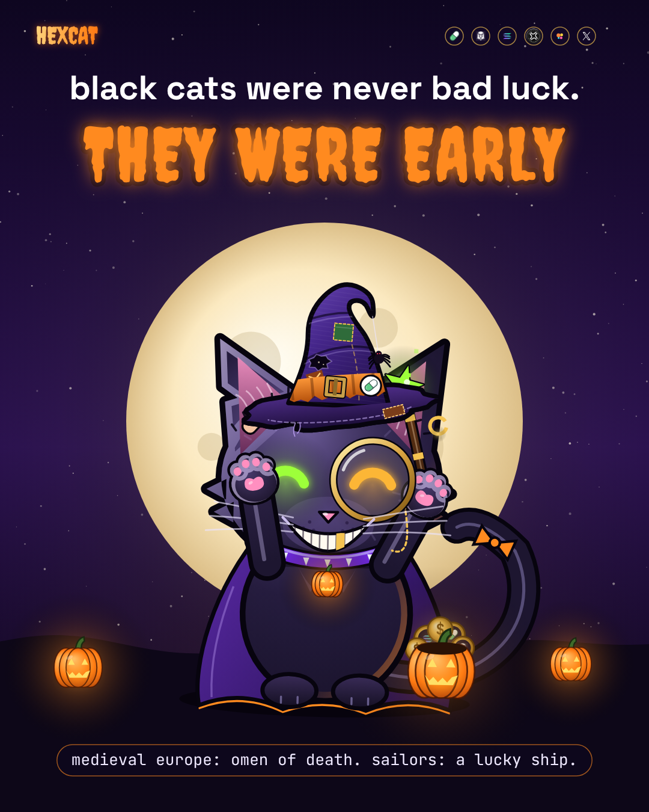 | 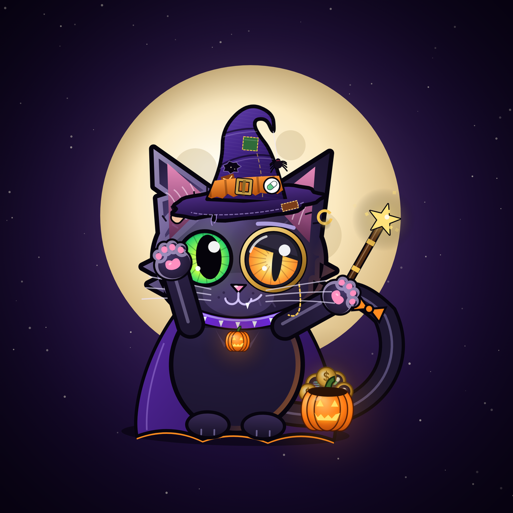 | 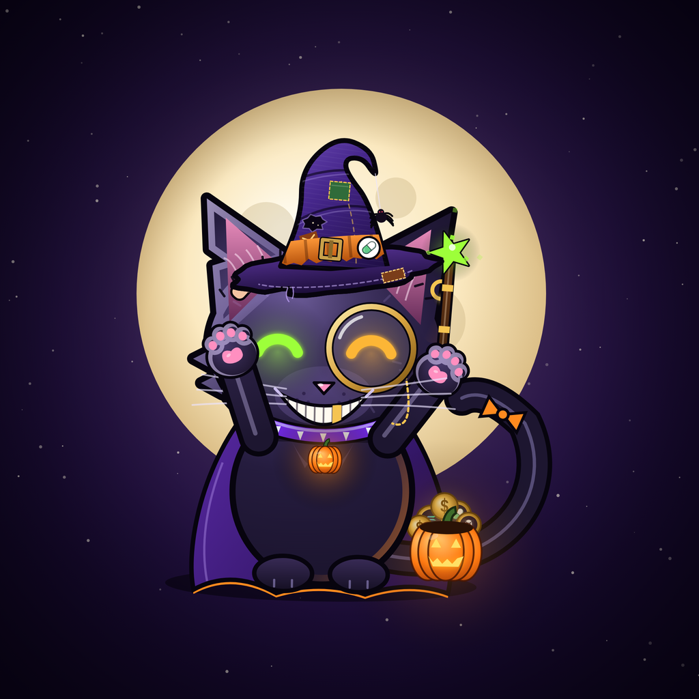 |
| `poster-early.png` | `hexcat-cover.png` (coin image) | `hexcat-cover-happy.png` |

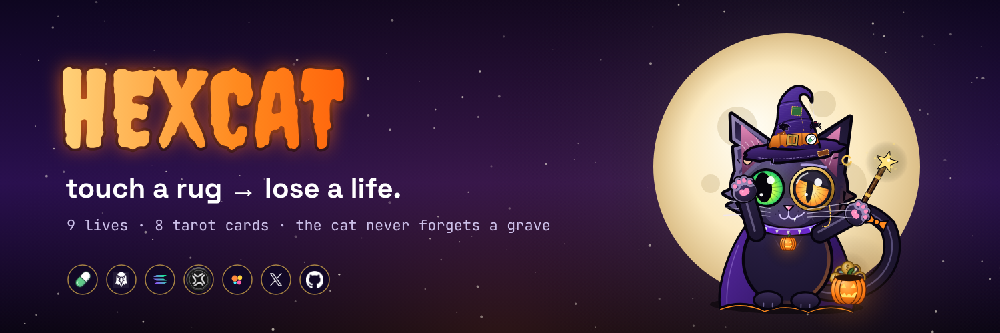<br/><sub><code>x-header.png</code> · 1500×500</sub>

<br/>

| | | | | | |
|:-:|:-:|:-:|:-:|:-:|:-:|
| 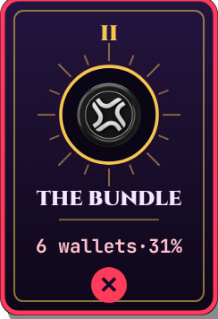 | 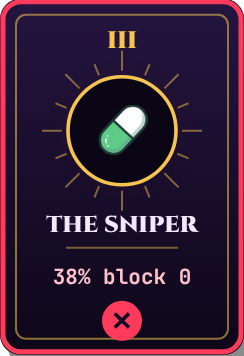 | 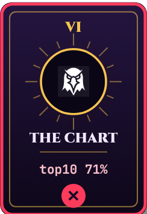 | 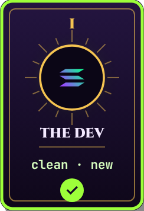 | 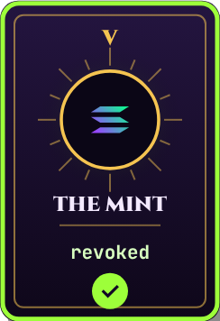 | 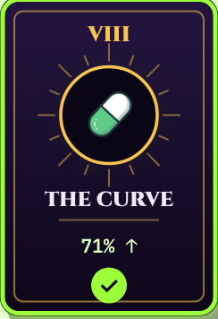 |

<sub>every card, both sides: <a href="assets/cards">assets/cards</a> · transparent mascots: <a href="assets/mascot">assets/mascot</a> · PFP: <a href="assets/creatives/pfp.png">pfp.png</a></sub>

</div>

## 🗺 Roadmap

- [x] 8 cards, one-red-card rule, graveyard memory
- [x] 9 lives kill switch, TP ladder, trailing runner
- [x] paper mode by default
- [ ] the web terminal from the video (crystal ball, live Soul Ledger)
- [ ] Telegram alerts: `TRICK! $XYZ — dev buried 3 times`
- [ ] shared graveyard: import other cats' tombstones
- [ ] Jito bundle submission for faster treats

## ❓ FAQ

**Does it make money?** Nobody can promise that. Most pump.fun coins go to zero, and every number in the video comes from a simulated paper night. The cat's job is to not buy the obvious rugs. Run it in paper mode for a few nights and judge your own numbers.

**Why 9 lives and not a max-loss setting?** It is a max-loss setting. It just hisses.

**Will it drain my wallet?** In paper mode it never touches a key. In live mode the key is read from your local `.env`, used only to sign locally, and should belong to a **burner** with only what you can afford to lose.

## ⚠️ Disclaimer

Experimental software for education. Not financial advice. Memecoins are extremely risky and you can lose everything. External APIs (PumpPortal, DexScreener, X, Solana RPC) and pump.fun curve parameters change; verify them before going live. You're responsible for your trades and for following the law where you live.

<a id="sources"></a>
<sub>[1] Solana Compass, *pump.fun launched 42,000 tokens in one day* (Dune: ~1.4% historical graduation; ~3% of users > $1,000) · [2] Historic Mysteries, *Black cat superstition*</sub>

<div align="center">

---


**trick or treat? the cat knows.**

⭐ star it if the cat saved you a rug

</div>
